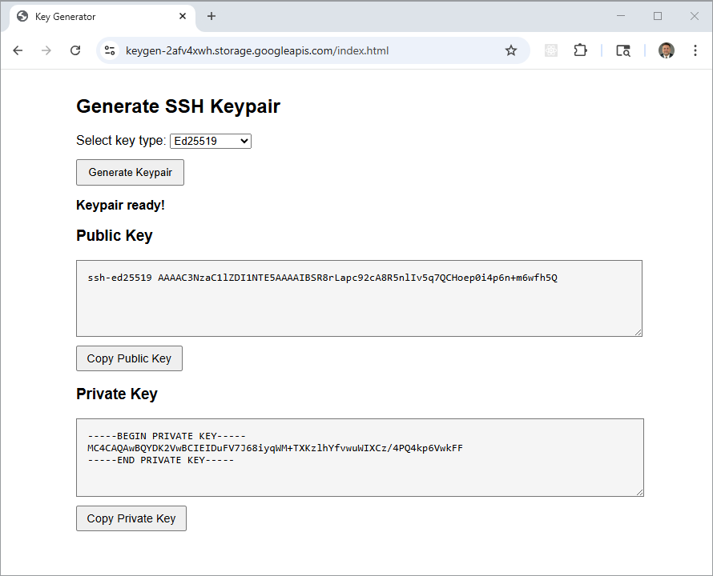

# SSH Key Generator on GCP: Cloud Functions, Pub/Sub and Firestore

An asynchronous **SSH key pair generator** with a browser front end. A
client submits a request to an HTTP **Cloud Function**, which records it in
**Firestore**, publishes it to a **Pub/Sub** topic and returns an ID. An
event-triggered worker function generates the key pair and writes it back
to the same Firestore document, and the client polls a second HTTP function
until the result is ready. A single-page web app, served from a public
**Cloud Storage** bucket, does this from the browser.



| Piece | Where | Role |
|---|---|---|
| **keygen** | Cloud Functions, `us-central1` | 2nd gen, Python 3.11; public (`allUsers` invoker); writes a `submitted` document and publishes the request; CORS allows any origin |
| **result** | Cloud Functions, `us-central1` | 2nd gen, Python 3.11; public; returns the document, or `404` `not_found` |
| **keygen-worker** | Cloud Functions, `us-central1` | 2nd gen, Python 3.11, 256 MB, 60 s; Eventarc trigger on the topic with retries enabled |
| **keygen-requests** | Pub/Sub | the request topic |
| **keygen-requests-sub** / **keygen-requests-dlq** | Pub/Sub | a pull subscription (30 s ack deadline, 5 delivery attempts) and its dead-letter topic; nothing consumes them |
| **keygen_results** | Firestore | one document per request, deleted by a TTL policy on `expireAt` (an hour after it's written) |
| **keygen-http-sa** / **keygen-worker-sa** | IAM | the HTTP functions get `datastore.user` and `pubsub.publisher`; the worker gets `datastore.user` and `pubsub.subscriber`, all project-wide |
| **keygen-&lt;suffix&gt;** | Cloud Storage, `US` | two buckets: the functions' source zips, and the public-read web bucket with `index.html` and `favicon.ico` |

## Architecture

<picture>
  <source media="(prefers-color-scheme: dark)" srcset="architecture-dark.svg">
  
</picture>

Regenerate with `python3 make_diagram.py`.

- **`01-pubsub/`**: the topic, the pull subscription and the dead-letter
  topic.
- **`02-functions/`**: `functions.tf` (source bucket, both service
  accounts and their roles, the three functions, the public invoker
  bindings) and one folder of code per function.
- **`03-webapp/`**: the web bucket, and `index.html.tmpl`, which `apply.sh`
  fills in with the API URL.

## API

The base URL is `https://us-central1-<project>.cloudfunctions.net`. There's
no authentication.

| Method | Path | Body | Returns |
|---|---|---|---|
| POST | `/keygen` | `{"key_type": "rsa" \| "ed25519", "key_bits": 2048 \| 4096}`, both optional | `200` `{"request_id": "<uuid>", "status": "submitted"}` |
| GET | `/result/{id}` | none | `200` with the document; `404` `{"status": "not_found"}` if there isn't one |

The document's `status` moves from `submitted` (written by `keygen`) to
`pending` (when the worker starts) to `complete` or `error`. When complete:

```json
{
  "request_id": "630f70c4-815c-41d1-ae52-6babf3a41b1f",
  "status": "complete",
  "key_type": "rsa",
  "key_bits": 2048,
  "public_key_b64": "c3NoLXJzYSBBQUFBQjNOemFDMXljMkVBQUFBREFRQUJBQUFCQVFD...",
  "private_key_b64": "LS0tLS1CRUdJTiBQUklWQVRFIEtFWS0tLS0tCk1JSUV2Z0lCQURBTkJn...",
  "createdAt": "...",
  "completedAt": "...",
  "expireAt": "..."
}
```

Both keys are base64-encoded. Decoded, the public key is in OpenSSH format
and the private key is an unencrypted PKCS#8 PEM. Any `key_type` other than
`ed25519` produces RSA. If generation fails, the worker records
`status: error` with an `error_message`; because it catches the exception,
Pub/Sub doesn't retry it.

## Prerequisites

* [A Google Cloud Account](https://console.cloud.google.com/)
* [Install gcloud CLI](https://cloud.google.com/sdk/docs/install)
* [Install Terraform](https://developer.hashicorp.com/terraform/install)
* [Install jq](https://jqlang.github.io/jq/download/) and `envsubst`
* A Firestore database in native mode, `(default)`, in the project; nothing
  here creates one

Put a service account key in the repository root as `credentials.json`. If
this is your first time following along, we recommend starting with this
video: [GCP + Terraform: Easy Setup](https://youtu.be/3spJpYX4f7I).

## Deploy

```bash
git clone https://github.com/mamonaco1973/gcp-pubsub-keygen.git
cd gcp-pubsub-keygen
./apply.sh
```

`check_env.sh` signs in with `credentials.json` and runs `api_setup.sh`,
which enables the APIs and turns on the Firestore TTL policy for
`keygen_results.expireAt`. `apply.sh` then applies `01-pubsub` and
`02-functions`, renders `03-webapp/index.html` with the API URL using
`envsubst`, and applies `03-webapp`. It ends by running `validate.sh`, which
submits an RSA 2048 request and polls every 2 seconds, up to 30 times, until
it's complete (set `KEY_TYPE` and `KEY_BITS` to try others):

```
NOTE: Submitted keygen request (630f70c4-815c-41d1-ae52-6babf3a41b1f).
NOTE: Polling for result...
NOTE: Attempt 1/30: pending...
NOTE: Key generation complete.

============================================================================
GCP Pub/Sub Quick Start - Validation Output
============================================================================

NOTE: Test Web URL:    https://keygen-<suffix>.storage.googleapis.com/index.html
NOTE: API Base URI:    https://us-central1-my-project.cloudfunctions.net
```

## Try it

1. Open the **Test Web URL**, pick a key type and size, and generate a key
   pair; the page polls for the result and shows both keys.
2. Or call the API with `curl`:

   ```bash
   curl -s https://us-central1-<project>.cloudfunctions.net/result/<id> \
     | jq -r .private_key_b64 | base64 -d > id_rsa && chmod 600 id_rsa
   ```

## Teardown

```bash
./destroy.sh
```

Terraform doesn't manage the Firestore documents; any left behind expire
through the TTL policy.

## Notes

- **Lab only.** The functions are public with CORS open to any origin, and
  generated private keys stay in Firestore for up to an hour (TTL deletion
  can lag behind `expireAt`). Anyone with a request ID can fetch its private
  key.
- The web page stops polling on any status other than `pending`. If the
  worker hasn't started by the first poll (1.5 s), it sees `submitted`,
  tries to decode keys that aren't there, and shows an error.
- `keygen-requests-sub` and its dead-letter topic aren't used: the worker's
  Eventarc trigger has its own subscription, so the pull subscription just
  collects copies of every message until they expire.
- `check_env.sh` checks only for `gcloud` and `terraform`, not `jq` or
  `envsubst`.
